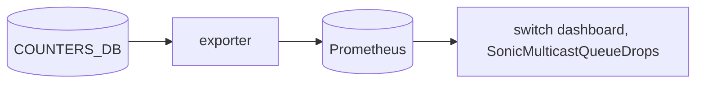

# Buffer pool and queue type collectors (`--collector.buffer_pool`, `--collector.queue_info`)

## 5W1H
| | |
|---|---|
| What | `sonic_buffer_pool_watermark_bytes{pool,type=current|user|persistent|periodic}` and `sonic_queue_info{device,queue,type=unicast|multicast}`. |
| Why | Pool occupancy shows whether the lossless pool is used at all (it was not, in the benchmark). Queue type removes the assumption that queues 10-19 are multicast; the multicast-drop alert and panel select queues by it. |
| Where | `COUNTERS_BUFFER_POOL_NAME_MAP`, `COUNTERS:<pool oid>`, `*_WATERMARKS:<pool oid>`; `COUNTERS_QUEUE_NAME_MAP`, `COUNTERS_QUEUE_TYPE_MAP`. |
| Which | 2 pools x up to 4 types; 1,280 queue_info series. |
| Who | Network owners, dashboards. |
| When | 30 s scrape. |
| How | A handful of reads per scrape. |

## Deployment and data flow

```mermaid
sequenceDiagram
  participant E as exporter
  participant R as redis
  E->>R: HGETALL pool name map, pool counters and watermark tables
  E->>R: HGETALL queue name map and queue type map
  E-->>E: gauges; unknown type reported as unknown
```

## Configuration
`--collector.buffer_pool`, `--collector.queue_info`.

## Results (M)
Switch: queues 0-9 unicast, 10-19 multicast on all 64 ports (640 + 640); pool watermarks 0 during the benchmark. The multicast-drop alert with the type join returned queues 10 and 13 only, the same drops as the index-based expression.

## Caveats
Pool watermark types other than periodic may be absent (V: persistent/user missing on this build).

## Rollback
Remove the flags; the multicast alert and panel then show no data.
