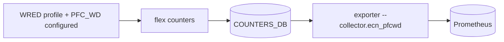

# ECN, WRED and PFC watchdog collector (`--collector.ecn_pfcwd`)

## 5W1H
| | |
|---|---|
| What | `sonic_queue_ecn_marked_packets_total`, `sonic_queue_wred_dropped_packets_total`, `sonic_pfcwd_queue_stormed`, `sonic_pfcwd_storm_detected_total`, `sonic_pfcwd_storm_restored_total`, `sonic_pfcwd_dropped_packets_total{direction}`. |
| Why | Answers whether the switch marks ECN and whether its PFC watchdog acts, once it is configured. |
| Where | `COUNTERS:<queue oid>` fields `SAI_QUEUE_STAT_WRED_*`, `PFC_WD_*`. |
| Which | Series appear only if the field exists. |
| Who | Network owners; rules `SonicLosslessDropsWithoutEcn`, `SonicPfcWatchdogStormDetected`. |
| When | 30 s scrape. |
| How | Pipelined read of 1,280 queue hashes. |

## Deployment and data flow

```mermaid
sequenceDiagram
  participant E as exporter
  participant R as redis
  E->>R: pipeline HGETALL COUNTERS:<queue oid> x 1280
  E-->>E: emit only existing fields; success + duration always
```

## Configuration
`--collector.ecn_pfcwd`.

## Results (M)
Synthetic hashes produce all series; the reference switch exports none (queue hashes carry 5 fields only; no WRED, no watchdog), collector_success = 1. The field names follow SONiC conventions and are unconfirmed on a switch that produces them (T).

## Caveats
Empty output means the switch cannot count, not that nothing happened: the dashboard shows an availability panel for exactly that.

## Rollback
Remove the flag.
