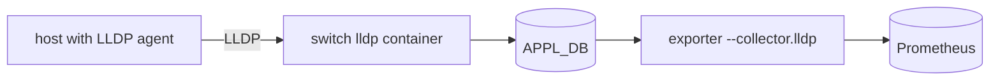
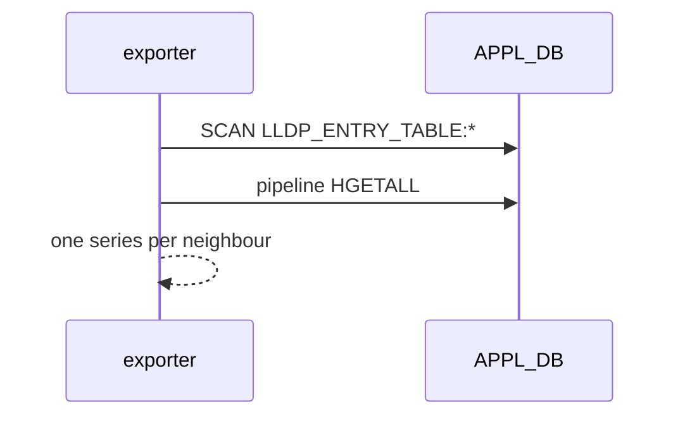

# LLDP collector (`--collector.lldp`)

## 5W1H
| | |
|---|---|
| What | `sonic_lldp_neighbor_info{device,remote_system_name,remote_port_id,remote_chassis_id} = 1`. |
| Why | The switch's own record of what is cabled to each port, for joining switch ports to hosts. |
| Where | `APPL_DB` `LLDP_ENTRY_TABLE:<port>`. |
| Which | Only ports whose peer sends LLDP. |
| Who | Dashboards, the cable-map checks. |
| When | 30 s scrape. |
| How | `SCAN` plus pipelined `HGETALL`. |

## Deployment and data flow

## Configuration
`--collector.lldp`.

## Results (M)
3 series on the reference switch: two bewn1 ports (remote ports are PF MACs) and the management port. 61 of 64 ports have no neighbour because the hypervisors do not run an LLDP agent.

## Caveats
Not sufficient for a full cable map; the proxy's `roce_link_info` (from the topology mapper) covers all ports.

## Rollback
Remove the flag.
