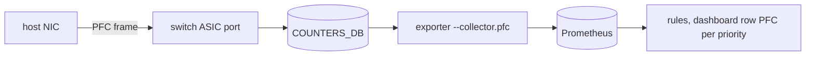

# PFC collector (`--collector.pfc`)

## 5W1H
| | |
|---|---|
| What | `sonic_pfc_received_frames_total{device,priority}`, `sonic_pfc_transmitted_frames_total{device,priority}`, and `sonic_pfc_pause_duration_microseconds_total{device,priority,direction}` when the SAI exposes it. |
| Why | Whether a lossless switch ever asks senders to pause, and which receiver pauses it, was invisible although the counters are in redis. |
| Where | `COUNTERS_DB` `COUNTERS:<port oid>`: `SAI_PORT_STAT_PFC_<p>_{RX,TX}_PKTS`. |
| Which | 64 ports x 8 priorities x rx/tx = 1,024 series. |
| Who | Network owners read it; rules `SonicLosslessDropsWithoutPfcTx`, `SonicPfcFramesReceivedStorm`, `SonicPfcOnUnexpectedPriority`. |
| When | Scrape 30 s, cache 15 s. |
| How | Port hashes read in one pipeline; fields that do not exist are not exported. |

## Deployment


## Data flow
```mermaid
sequenceDiagram
  participant E as exporter
  participant R as redis
  E->>R: HGETALL COUNTERS_PORT_NAME_MAP
  E->>R: pipeline HGETALL COUNTERS:<oid> x 64
  E-->>E: 8 priorities x rx/tx per port; duration only if the field exists
```

## Configuration
`--collector.pfc`. No other option.

## Results (M)
Real switch (AS7816, SONiC 202006): PFC TX 0 on all 64 ports; PFC RX priority 3 = 0; priority 2 holds the hosts' lossless pauses (2.4e9 on the bewn1 port). Under a line-rate benchmark the host `tx_prio3_pause` equals the switch PFC RX within 0.25% on 8 links. Exporter values pass a bracket test against redis (76/76 checks).

## Caveats
Some SAI builds count received PFC under another priority index than on the wire (here 3 is counted as 2). No pause-duration field on this build (V).

## Rollback
Remove the flag.
