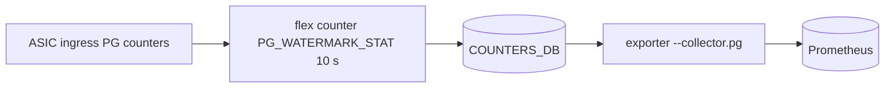
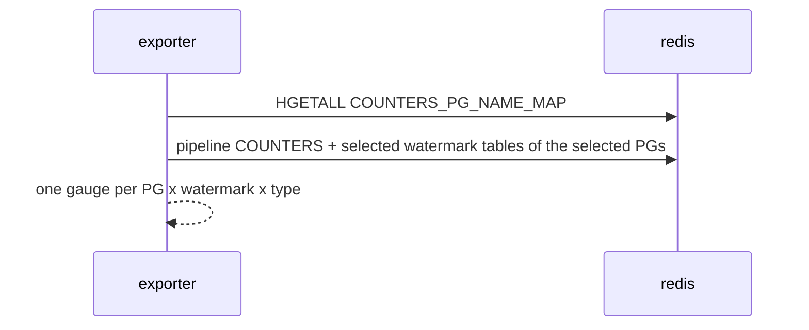

# Priority group collector (`--collector.pg`)

## 5W1H
| | |
|---|---|
| What | `sonic_pg_watermark_bytes{device,pg,watermark=shared|headroom,type=user|persistent|periodic}` and `sonic_pg_dropped_packets_total{device,pg}` (only if the switch counts PG drops). |
| Why | Shows whether the ingress lossless buffers fill and PFC headroom is used. In the line-rate benchmark PG3/PG4 stayed at 0 while 636 Gb/s flowed: the congestion was at the egress queue, which is why the switch never sent PFC. |
| Where | `COUNTERS_PG_NAME_MAP`, `COUNTERS:<pg oid>`, `{USER,PERSISTENT,PERIODIC}_WATERMARKS:<pg oid>`. |
| Which | Default PGs 3,4 and all three types = 768 series; PGs 0-7 with periodic only = 512 series. |
| Who | Network owners; rules `SonicPgHeadroomUsed`, `SonicPgDrops`. |
| When | Watermarks are sampled by the switch every 10 s. |
| How | Pipelined reads; options choose PGs and types. |

## Deployment and data flow

## Configuration
`--collector.pg`, `--collector.pg.include-pgs=3,4` (a list, a range such as `0-7`, or `all`), `--collector.pg.types=user,persistent,periodic` (any subset; `periodic` alone is the cheapest way to see all eight PGs).

## Results (M)
Fixture tests for default, all PGs and periodic-only (32 series for 2 ports x 8 PGs x 2 watermarks). Switch: PG3/PG4 watermarks 0 under load; PG0 9 KB persistent on the busiest port.

## Caveats
No PG drop counter group on the reference switch (V): `sonic_pg_dropped_packets_total` is absent there. Headroom is used only after PFC fired.

## Rollback
Remove the flag.
