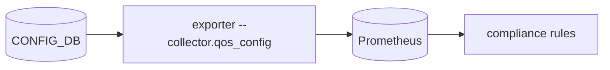

# QoS configuration compliance collector (`--collector.qos_config`)

## 5W1H
| | |
|---|---|
| What | `sonic_port_pfc_enabled`, `sonic_port_qos_map_bound`, `sonic_buffer_pg_profile_info`, `sonic_buffer_queue_profile_info`, `sonic_queue_wred_profile_bound`, `sonic_wred_ecn_enabled`, `sonic_pfcwd_configured`, `sonic_pfcwd_default_enabled`. |
| Why | The configured lossless setup becomes series, so a missing egress lossless profile, missing ECN or watchdog alerts before load arrives. |
| Where | `CONFIG_DB`: `PORT_QOS_MAP`, `BUFFER_PG`, `BUFFER_QUEUE`, `QUEUE`, `WRED_PROFILE`, `PFC_WD`, `DEVICE_METADATA`. |
| Which | 960 series on a 64-port switch. |
| Who | Network owners; rules of group `RoCE-Switch-Config-Compliance`. |
| When | 30 s scrape; configuration changes rarely. |
| How | `SCAN` per table pattern and one pipeline (about 330 hashes). |

## Deployment and data flow

```mermaid
sequenceDiagram
  participant E as exporter
  participant C as CONFIG_DB
  E->>C: SCAN tables, pipelined HGETALL
  C-->>E: PFC on 3,4; BUFFER_PG 3-4 lossless; no BUFFER_QUEUE; no WRED; no PFC_WD
  E-->>E: absent series are the finding (unless on ...)
```

## Configuration
`--collector.qos_config`.

## Results (M)
Reference switch: PFC enabled for 3,4 on 64/64 ports; ingress lossless profile bound everywhere; 0 egress profiles, 0 WRED, 0 watchdog; `dscp_to_tc_map` on 8 ports. During the benchmark `SonicLosslessEgressProfileMissing` fired for 64 ports.

## Caveats
CONFIG_DB is intent, not what the ASIC applied. The queue-list match in the rule is a pattern (`.*3.*`): a range such as 0-6 needs a manual check.

## Rollback
Remove the flag.
