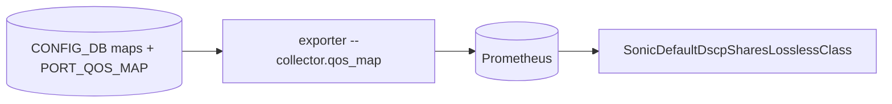

# Classification map collector (`--collector.qos_map`)

## 5W1H
| | |
|---|---|
| What | `sonic_dscp_to_tc{name,dscp,tc}`, `sonic_dot1p_to_tc{name,dot1p,tc}`, `sonic_tc_to_queue{name,tc,queue}`, `sonic_tc_to_pg{name,tc,pg}` and `sonic_port_qos_map_info{device,type,name}` (which map is bound to which port). |
| Why | In the AZURE DSCP map DSCP 0 (unmarked traffic) goes to traffic class 3, the lossless class. TCP of Ceph, Kafka and management then shares the lossless queue and its drops (H for the effect, V for the map). A metric makes this alertable (`SonicDefaultDscpSharesLosslessClass`). |
| Where | `CONFIG_DB`: `DSCP_TO_TC_MAP`, `DOT1P_TO_TC_MAP`, `TC_TO_QUEUE_MAP`, `TC_TO_PRIORITY_GROUP_MAP`, `PORT_QOS_MAP`. |
| Which | 64 DSCP series per map plus the port bindings. |
| Who | Network owners. |
| When | 30 s scrape. |
| How | `SCAN` and a pipeline; one series per map entry. |

## Deployment and data flow

```mermaid
sequenceDiagram
  participant E as exporter
  participant C as CONFIG_DB
  E->>C: SCAN map tables and PORT_QOS_MAP
  C-->>E: AZURE: 0->3, 1->1 ... ; Ethernet1 bound to AZURE
  E-->>E: join in PromQL on (instance, name)
```

## Configuration
`--collector.qos_map`.

## Results (M)
Fixture (real switch): `sonic_dscp_to_tc{name="AZURE",dscp="0",tc="3"}` exported, 64 DSCP series, `tc_to_pg_map` binding of Ethernet0 = AZURE. Rule unit test: fires only for the port bound to a map with DSCP 0 -> TC 3.

## Caveats
The rule assumes class 3 is the lossless class. Ports without a DSCP binding classify by the hardware default and are not covered by this rule.

## Rollback
Remove the flag.
