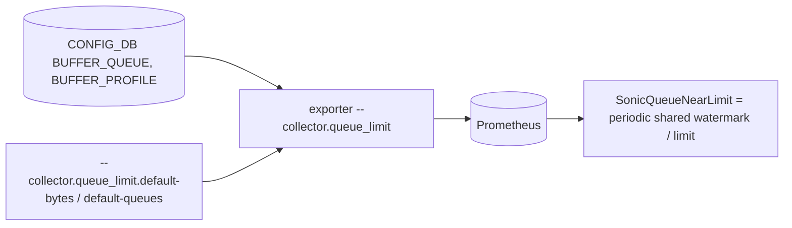

# Egress queue limit collector (`--collector.queue_limit`)

## 5W1H
| | |
|---|---|
| What | `sonic_queue_limit_bytes{device,queue,source=profile|default}`: the buffer limit of an egress queue, so that `watermark / limit` shows saturation before drops. |
| Why | During the line-rate benchmark every dropping port peaked at the same 10,314,304 bytes of queue-3 watermark: a fixed ceiling. A ratio rule (`SonicQueueNearLimit`, 90%) warns before the queue tail-drops. |
| Where | `CONFIG_DB` `BUFFER_QUEUE\|<port>\|<queues>` -> `BUFFER_PROFILE` `size` (or `static_th` when size is 0); queues without a profile get an optional default. |
| Which | One series per queue with a limit. |
| Who | Network owners; platform owners set the default. |
| When | 30 s scrape. |
| How | `SCAN` and one pipeline over CONFIG_DB; a default may be given for queues without a profile. |

## Deployment and data flow

```mermaid
sequenceDiagram
  participant E as exporter
  participant C as CONFIG_DB
  E->>C: SCAN BUFFER_QUEUE|*, BUFFER_PROFILE|* ; pipeline HGETALL
  E-->>E: limit per queue from the profile; default for the listed queues that have none
```

## Configuration
`--collector.queue_limit`, `--collector.queue_limit.default-bytes=<n>` (0 = none, default), `--collector.queue_limit.default-queues=3,4`.

## Results (M)
Fixture tests: no series without profile or default; profile limit 5,000,000 for queues 3-4 of a port; default limit only for queues without a profile. The reference switch has no `BUFFER_QUEUE` entry, so only the default produces series there; the rack is deployed with the default set to the measured ceiling 10,314,304 bytes for queues 3,4 (source label `default`).

## Caveats
The source of the 10.3 MB ceiling is a hypothesis (close to the 11.2 MB ingress lossless profile size). The default is an observed value, not a configured one; replace it when an egress profile exists.

## Rollback
Remove the flag; `SonicQueueNearLimit` then returns no data.
