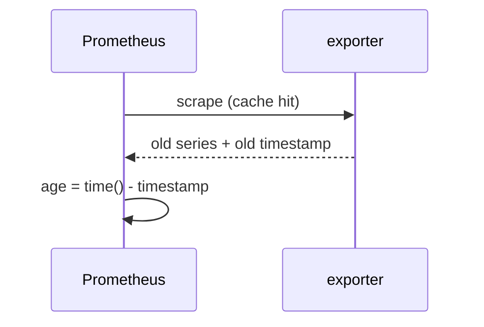

# Refresh timestamps (`sonic_<collector>_last_refresh_timestamp_seconds`)

## 5W1H
| | |
|---|---|
| What | A gauge per collector with the Unix time of its last redis read. |
| Why | Collectors are cached for 15 s, so an exporter value can be that old. A value check against redis failed 17 of 76 times until the cache was taken into account; a rule needs the age to detect an exporter that serves old data because its redis reads hang (`SonicExporterStale`). |
| Where | The four original collectors and every `cachedCollector`. |
| Which | One series per collector. |
| Who | Anyone comparing exporter values with the switch CLI; rule `SonicExporterStale`. |
| When | Updated at every refresh. |
| How | Set when a refresh completes. |

## Deployment and data flow
```mermaid
flowchart LR
  R[redis read] --> C[collector cache] --> M[last_refresh_timestamp_seconds] --> P[(Prometheus)] --> A[SonicExporterStale: time() - timestamp > 120 s]
```


## Configuration
None.

## Results (M)
Unit tests check the timestamp of the queue, interface and PFC collectors (> 1.7e9). The rule is unit-tested with promtool.

## Caveats
A failed refresh also updates the timestamp of the cached failure result in the new collectors; the success gauge tells the two apart.

## Rollback
Not removable by a flag; it is one series per collector.
